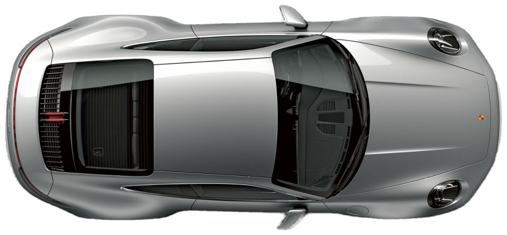

# 🏎️ Scroll Hero - Porsche 911 Edition

An interactive, high-performance scroll-driven hero section featuring a top-down view of a **Silver Porsche 911**, built with **Next.js (App Router)**, **GSAP ScrollTrigger**, and **Lenis Smooth Scroll** on an ultra-sleek **dark charcoal** theme.

---

## 🌐 Live Demo
- **Local URL**: [http://localhost:3000](http://localhost:3000)

---

## 🎨 Design & Aesthetic System

- **Dark Charcoal Theme**:
  - **Page Background**: `#0f1215` (deep charcoal)
  - **Hero Canvas**: `#14181c` with subtle ambient radial vignette
  - **Road Strip**: `#1b1f24` with realistic dashed highway lane dividers (`rgba(255,255,255,0.12)`) and static road surface lighting
  - **Stat Cards**: `#1a1e23` with `1px` border (`rgba(255,255,255,0.08)`) and soft depth shadows
  - **Accent Trail**: Luminous emerald green (`#22c55e`) with glowing aura (`rgba(34,197,94,0.45)`)
  - **Typography**: Near-white `#f2f4f5` headline with text-shadow for high contrast, pure white stat numbers, and WCAG AA compliant muted gray (`#8b929a`) labels

---

## 🛠️ Tech Stack

- **Framework**: [Next.js 15+ / 16 (App Router)](https://nextjs.org/)
- **Language**: [TypeScript](https://www.typescriptlang.org/)
- **Styling**: [Tailwind CSS v4](https://tailwindcss.com/)
- **Animation Engine**: [GSAP](https://gsap.com/) & [@gsap/react](https://gsap.com/resources/React/)
- **Scroll Synchronization**: [GSAP ScrollTrigger](https://gsap.com/docs/v3/Plugins/ScrollTrigger/)
- **Smooth Momentum Scrolling**: [Lenis](https://lenis.darkroom.engineering/)

---

## ⚡ Animation Architecture & Mechanics

### 1. Page-Load Entrance Animation (`introTl`)
- **Car Reveal**: The silver Porsche 911 fades and scales smoothly into its starting spot on the far left of the road.
- **Sequential Stat Badges**: Four metric cards enter one by one in staggered sequence (`y: 25 -> 0`, `opacity: 0 -> 1`).
- **Dynamic Percentage Counters**: Numerical metrics count up from 0 to their target values (`58%`, `23%`, `27%`, `40%`) in sync with each card's arrival.
- **Zero Collision**: Intro animations animate `opacity` and `scale`, leaving the horizontal `x` transform exclusively to ScrollTrigger.

### 2. Scroll-Linked Scrubbed Animation
- **Pinned Container**: Pinned `.track` canvas inside a `200vh` scroll track with `scrub: true` and `ease: "none"`.
- **Dynamic Travel Boundary**: Function-based `x: () => roadWidth - carWidth` with `invalidateOnRefresh: true` ensures the car starts flush on the left road edge and finishes flush on the right road edge across all viewports.
- **Glowing Green Trail**: Trails the car's mid-body and rear wheels seamlessly as it accelerates forward, contracting smoothly on reverse scroll.
- **Cached Headline Reveal**: Letters of `"WELCOME ITZFIZZ"` are pre-measured on load/resize and revealed letter-by-letter as the car passes each character, with zero layout thrashing (`getBoundingClientRect` is never called inside scroll updates).

### 3. Lenis & ScrollTrigger Integration
- Lenis provides momentum-based smooth scroll physics.
- `lenis.on('scroll', ScrollTrigger.update)` synchronizes Lenis scroll events directly with GSAP.
- `gsap.ticker.add((time) => lenis.raf(time * 1000))` and `gsap.ticker.lagSmoothing(0)` keep framerate ticks locked 1:1 with requestAnimationFrame.

---

## ♿ Accessibility & Responsiveness

- **`prefers-reduced-motion`**: Fully respects user motion preferences via `gsap.matchMedia()`, rendering final resting states immediately and disabling Lenis.
- **React Strict Mode Safe**: Clean component unmounting and timeline cleanup via `useGSAP` and `mm.revert()`.
- **Responsive Breakpoints**: Seamless scaling across mobile (375px), tablet (768px), and desktop (1440px+). Fluid `clamp()` typography and proportionate road/car heights prevent clipping or horizontal overflow.
- **WCAG Contrast**: High-contrast typography and subtle glassmorphic backdrop filters ensure clear legibility across dark surfaces.
- **Descriptive Alt Text**: Car imagery includes accessible, informative screen-reader descriptions.

---

## 📄 License
MIT License. Created with ❤️.

